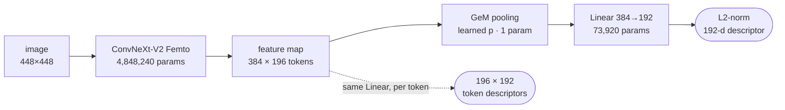
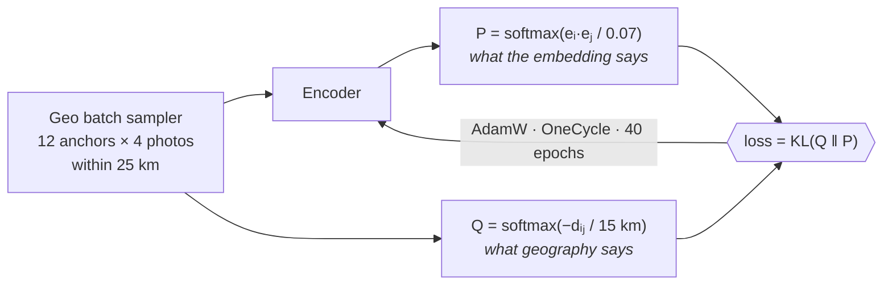
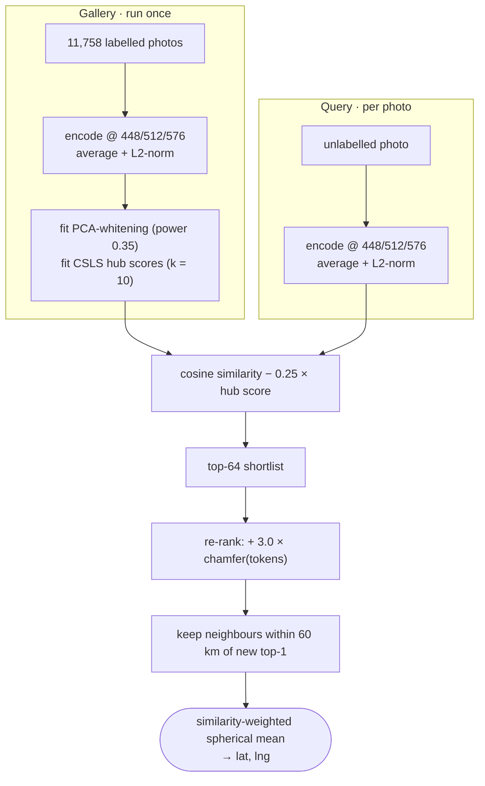
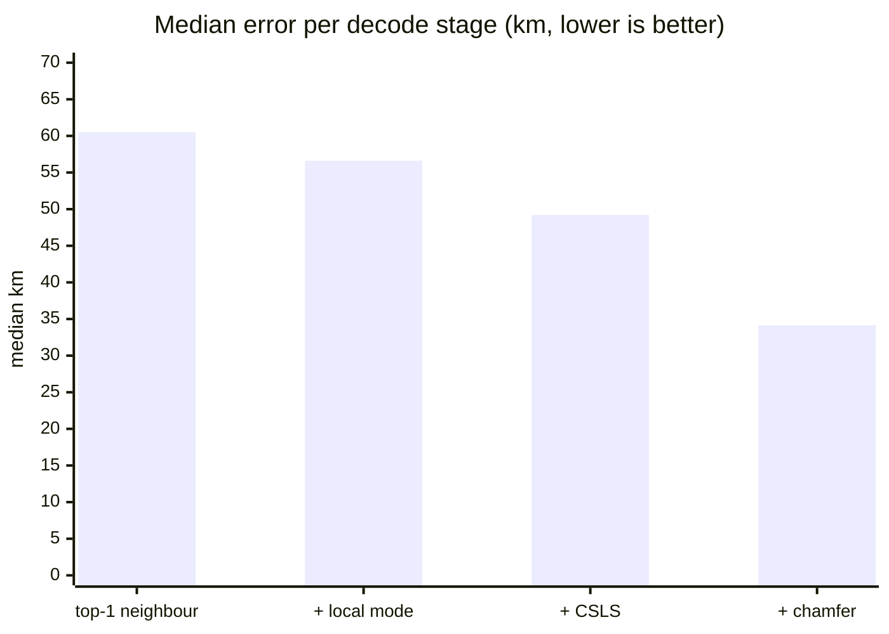

# Where in Europe was this photo taken?

Street-level image geolocation across 12 European countries with a **4.9M-parameter** model,
trained only on ~11.8k labelled photos. Instead of regressing coordinates, it **retrieves**
visually similar labelled photos and reads the location off them.

| | |
|---|---|
| **Median error** | **34.16 km** (mean 359.5 km) on a held-out 20% split |
| **Accuracy** | 47.4% < 25 km · 65.9% < 200 km · 83.5% < 750 km |
| **Parameters** | 4,922,161 (budget: 5,000,000) |
| **Backbone** | ConvNeXt-V2 Femto, ImageNet-1k init |
| **Compute** | ≈ 74 min end-to-end on one NVIDIA RTX 4000 Ada (20 GB) |

Countries: Belarus, Finland, France, Germany, Iceland, Italy, Norway, Poland, Spain, Sweden,
Turkey, United Kingdom. The task definition is in [`docs/CHALLENGE.md`](docs/CHALLENGE.md), and the
full report is in [`writeup/Writeup.pdf`](writeup/Writeup.pdf).

---

## How it works

A regressor has to store the map inside its weights, and 5M weights can't hold every European
street. This model learns a **192-d descriptor** where photos taken close together end up close
together. The map lives in a **gallery** of labelled descriptors, not in the weights.

### Encoder: the only part with weights



The token descriptors reuse the same projection, so the re-ranking stage adds **zero** parameters.

### Training: soft-target geographic contrastive loss



- **Soft targets.** Every image in the batch counts as a positive in proportion to its
  great-circle distance, with no fixed positive/negative radius. **`τ = 15 km` is the key
  hyper-parameter**: at 250 km the model learned *region* identity and plateaued at 126 km.
- **Geo-aware batches.** Only ~25% of images have a partner within 500 m, so random batches
  rarely contain positives. Sampling clusters guarantees positives and hard negatives.
- **No horizontal flip.** Mirroring swaps driving side and sign text, which are strong country
  cues. RandAugment `rand-m7-n2-mstd0.5` plus random resized crop (0.5–1.0) are used instead.
- **No checkpoint selection.** The last epoch of a fixed 40-epoch budget is kept, so the
  validation split never influences model selection.

### Inference: parameter-free retrieval decoder



| stage | why it's there |
|---|---|
| **Multi-scale TTA** | Training is at 448 px; larger inputs give GeM a finer grid to pool over. |
| **PCA-whitening** | A few directions (vegetation, light) swamp the fine cues. Power 0.35 avoids over-amplifying noise. |
| **CSLS** [7] | Subtracts each gallery image's "hubness" so images that match everything stop crowding the shortlist. Fitted gallery-only (inductive). |
| **Chamfer re-ranking** [8] | Patch-to-patch matching on tokens separates "same street" from "same country". The biggest single gain. |
| **Local-mode decode** | A mean on the unit sphere, restricted to 60 km around the top-1, so one confident match isn't averaged away. |

### Ablation (held-out 20%, 2,352 images)



| stage | median km | mean km | < 25 km | < 200 km | < 750 km |
|---|---:|---:|---:|---:|---:|
| top-1 neighbour (TTA + whitening) | 60.52 | 410.4 | 42.0% | 62.7% | 80.7% |
| + local-mode decode | 56.61 | 410.9 | 42.3% | 62.7% | 80.8% |
| + CSLS hubness correction | 49.21 | 403.4 | 43.3% | 63.5% | 81.3% |
| **+ chamfer re-ranking** | **34.16** | **359.5** | **47.4%** | **65.9%** | **83.5%** |

---

## Reproducing

### 1. Environment

Tested with **Python 3.12.3, CUDA 12.6, PyTorch 2.13.0+cu126, timm 1.0.29**. All versions are
pinned in [`requirements.txt`](requirements.txt).

```bash
python3 -m venv .venv && source .venv/bin/activate
make install        # = pip install -r requirements.txt --extra-index-url https://download.pytorch.org/whl/cu126
```

Training and embedding need a **CUDA GPU** (8 GB is enough). `predict.py`, `eval.py` and
`verify.py` also run on CPU.

### 2. Data

The dataset comes from the challenge organisers and is **not redistributed** in this repo.
Place it like this, or point `GEO_DATA` at it:

```
geo_dataset/
├── train/              11,758 labelled .jpg (512×512)
├── holdout_public/      2,400 unlabelled .jpg
└── train_labels.csv    filename,country,iso,lat,lng
```

```bash
export GEO_DATA=/path/to/geo_dataset
```

### 3. Run

| command | what it does | time | deterministic? |
|---|---|---:|---|
| `make verify` | parameter count of the shipped weights + `predictions.csv` format check | seconds | yes |
| `make predict` | shipped weights → gallery/holdout embeddings → `predictions.csv` | ~7 min | **yes**, bit-identical to the committed file |
| `make validate` | train on 80%, score the held-out 20% (ablation + per-country) | ~65 min | within run-to-run noise |
| `make train` | retrain on all 11,758 images into `model/retrain/` | ~67 min | within run-to-run noise |

After `make train`, use `make predict CKPT=model/retrain/final.pt` to predict with the new
weights. Each target is a short sequence of plain `python` calls, listed in the [`Makefile`](Makefile).

### Reproducibility guarantees

- **Inference is exact.** Embedding and decoding are deterministic for a given checkpoint.
  Chamfer tokens are computed in fp32 because small score gaps decide the re-ranking.
- **Training is seeded, not bit-exact.** `--seed 0` fixes the split, the batch sampler and torch
  RNGs. fp16 autocast and cuDNN kernel selection still cause small run-to-run differences.
- **The split is regenerated, not stored.** `geo.split_train_val` rebuilds the stratified 80/20
  split from `--seed`. Keep `--seed` and `--val-frac` the same between `train.py` and `eval.py`.
- **No test-set leakage.** Whitening and hub statistics are fitted on the gallery only. In
  validation, the held-out 20% is never a retrieval candidate. Decode hyper-parameters are frozen
  (table below), and `eval.py` performs no search.
- **Order checks.** Gallery embeddings are stored in `train_labels.csv` row order, and
  `predict.py`/`eval.py` refuse mismatched files.
- **Offline inference.** Only `train.py` downloads anything (the ~20 MB ImageNet weights from the
  Hugging Face Hub). Set `HF_HOME` to a warmed cache to run fully offline.

| decode flag | value | meaning |
|---|---:|---|
| `--csls-k` | 10 | gallery neighbours defining the hub score |
| `--csls-beta` | 0.25 | weight of the hub subtraction |
| `--topk` | 64 | shortlist size for re-ranking |
| `--lam` | 3.0 | weight of the chamfer term |
| `--radius` | 60 km | decode neighbourhood around the top-1 |
| `--temp` | 0.1 | softmax temperature on similarity weights |

Training defaults (see `python train.py -h`): 448 px, 192-d, τ = 15 km, temp 0.07, lr 3e-4 for the
head and 1e-4 for the backbone, weight decay 0.01, batch 12×4, 40 epochs. The exact arguments and
loss curve of the shipped model are in [`model/full_data/config.json`](model/full_data/config.json).

---

## Repository layout

```
├── geo.py              model, geometry and retrieval decoder (shared core)
├── train.py            training (--val-frac 0 full data, 0.2 for validation)
├── embed.py            multi-scale descriptors + token descriptors → .npz
├── predict.py          gallery + holdout embeddings → predictions.csv
├── eval.py             held-out scoring: ablation ladder + per-country breakdown
├── verify.py           parameter budget + predictions.csv checks (CPU)
├── Makefile            one target per pipeline step
├── model/full_data/    final.pt (19 MB) + config.json
├── predictions.csv     2,400 holdout predictions
├── writeup/            report (PDF) + architecture figures
├── docs/               challenge spec, project plan, progress log, literature notes
└── experiments/        archived earlier approaches (regression, geo-cells, T2–T4), not needed to reproduce
```

---

## What didn't work

- **Coordinate regression and geo-cell classification** [2–4]. Nine variants, including
  hierarchical country→cell→offset heads, multi-crop fusion and label smoothing, all plateaued at
  122–155 km. An oracle analysis showed cell accuracy, not resolution, was the ceiling. Code is in
  `experiments/`.
- **`τ = 250 km`** learned region identity instead of place identity.
- **k-reciprocal re-ranking, α-query expansion, label propagation, transductive whitening** were
  neutral or worse. They reshuffle neighbours that were already retrieved, but the real failure
  was the correct place missing from the shortlist.
- **Confidence-gated snapping to the top-1** gave exactly 0 km gain, because local-mode decoding
  already returns the top-1 when the shortlist agrees.
- **Higher training resolution (512/576)** cost 30–60% more time per epoch with no reliable gain.
- **Averaging cross-validation checkpoints** appeared to reach 26 km but was discarded as
  contaminated: any average of fold models has seen every validation image.
- Horizontal flip was never ablated. Disabling it is an assumption, not a measured result.

## References

1. S. Woo et al. *ConvNeXt V2: Co-designing and Scaling ConvNets with Masked Autoencoders.* CVPR 2023.
2. T. Weyand, I. Kostrikov, J. Philbin. *PlaNet: Photo Geolocation with Convolutional Neural Networks.* ECCV 2016.
3. E. Müller-Budack, K. Pustu-Iren, R. Ewerth. *Geolocation Estimation of Photos using a Hierarchical Model and Scene Classification.* ECCV 2018.
4. L. Haas, M. Skreta, S. Alberti, C. Finn. *PIGEON: Predicting Image Geolocations.* CVPR 2024.
5. F. Radenović, G. Tolias, O. Chum. *Fine-tuning CNN Image Retrieval with No Human Annotation.* TPAMI 2019 (GeM).
6. H. Jégou, O. Chum. *Negative Evidences and Co-occurrences in Image Retrieval: The Benefit of PCA and Whitening.* ECCV 2012.
7. A. Conneau et al. *Word Translation Without Parallel Data.* ICLR 2018 (CSLS).
8. S. Hausler et al. *Patch-NetVLAD: Multi-Scale Fusion of Locally-Global Descriptors for Place Recognition.* CVPR 2021.
9. B. Cao, A. Araujo, J. Sim. *Unifying Deep Local and Global Features for Image Search.* ECCV 2020 (DELG).
10. P. Khosla et al. *Supervised Contrastive Learning.* NeurIPS 2020.
11. E. D. Cubuk et al. *RandAugment: Practical Automated Data Augmentation with a Reduced Search Space.* NeurIPS 2020.
12. Z. Zhong et al. *Re-ranking Person Re-identification with k-reciprocal Encoding.* CVPR 2017.
