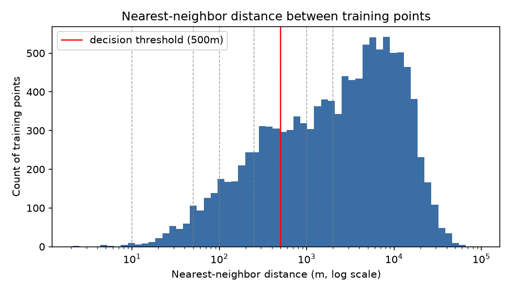

# Geographic leakage check — summary

Training points: 11758 · Exact-duplicate (lat, lng) rows: 0

## Nearest-neighbor distance (meters)
min=2.09  p1=28.14  median=2507.98  p99=31022.20  max=95774.6

## Multi-point cluster sweep
| threshold (m) | multi-point clusters | points affected | % of dataset | max cluster size |
|---:|---:|---:|---:|---:|
| 10 | 8 | 16 | 0.14% | 2 |
| 50 | 152 | 312 | 2.65% | 4 |
| 100 | 368 | 786 | 6.68% | 8 |
| 250 | 784 | 1765 | 15.01% | 8 |
| 500 | 1198 | 2888 | 24.56% | 32 |
| 1000 | 1557 | 4089 | 34.78% | 33 |
| 2000 | 1900 | 5435 | 46.22% | 37 |

## Decision (threshold = 500m, cutoff = 1.0% of points)
- Leakage found: **True**
- Recommended CV strategy: **group-stratified k-fold (group = location cluster, stratify by country)**
- Cluster assignments saved to `clusters_500m.csv` (filename -> cluster_id, cluster_size).

## Per-country share of points in a multi-point cluster (decision threshold)
| country | points in multi-cluster | total points | fraction |
|---|---:|---:|---:|
| Iceland | 456 | 960 | 0.4750 |
| Norway | 454 | 1000 | 0.4540 |
| Belarus | 253 | 864 | 0.2928 |
| Spain | 279 | 1000 | 0.2790 |
| Turkey | 267 | 1000 | 0.2670 |
| Finland | 259 | 1000 | 0.2590 |
| United_Kingdom | 227 | 1000 | 0.2270 |
| Italy | 208 | 1000 | 0.2080 |
| Sweden | 190 | 1000 | 0.1900 |
| Poland | 119 | 934 | 0.1274 |
| France | 102 | 1000 | 0.1020 |
| Germany | 74 | 1000 | 0.0740 |

